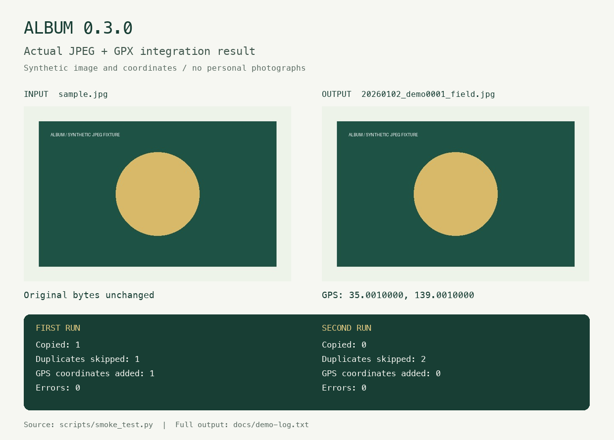

# ALBUM 0.3.0

**写真を撮影日ごとに整理し、必要に応じてGPSログから位置情報を付けるツールです。**

ALBUMは、フォルダーに集めた写真を撮影日順にコピーし、撮影者名と場所を含む統一した名前を付けます。SHA-256でコピーを検証し、同一内容の写真を重複して取り込みません。処理はすべて手元のコンピューターで行います。写真や位置情報を外部へ送信しません。

[ダウンロード](https://github.com/yoneoka-katsuhiro/ALBUM/releases) · [English](README.md) · [日本語マニュアル](docs/MANUAL-ja.md) · [監査結果](docs/AUDIT.md)



*同梱の検証スクリプトで実際に処理したJPEGと出力ログです。写真の画素と入力原本を保ちながら、出力コピーにGPS情報を追加しています。撮影画像・実測経路ではありません。*

## ダウンロードして使う

| ZIPファイル | 対象 | 配布内容 |
| --- | --- | --- |
| `ALBUM-v0.3.0-macOS-arm64.zip` | Apple Silicon Mac | Python実行環境とExifToolを同梱。macOS標準のPerlを使用します。 |
| `ALBUM-v0.3.0-Windows-x64.zip` | Windows 10/11、64 bit | Python、ExifTool、ExifTool用Perlを同梱。 |

[Releases](https://github.com/yoneoka-katsuhiro/ALBUM/releases)で対象のZIPを選び、**フォルダー全体**を展開してください。`_internal`と`exiftool`は実行ファイルの隣に必要です。ALBUMはコマンドラインツールです。写真を選ぶGUIはまだありません。未署名またはアドホック署名の開発配布であり、Apple公証・Windows Authenticode署名はありません。各版の検証状況はリリースノートに記載します。

1. 展開した`album`フォルダーの`input_image`に写真のコピーを入れます。
2. macOSではターミナル、WindowsではPowerShellで`album`フォルダーを開きます。
3. 以下を実行します。撮影者名と場所には英数字・`-`・`_`を使います。

macOS:

```bash
./album --photographer yoneoka --location yakushima
```

Windows PowerShell:

```powershell
.\album.exe --photographer yoneoka --location yakushima
```

出力例: `output/20260102_yakushima/20260102_yoneoka0001_yakushima.jpg`

まず試す場合は同梱の[合成デモ](demo/README.md)を使えます。展開した`album`フォルダーで`./album --project-dir demo --photographer demo --location field --geotag --gps-timezone +09:00`を実行します。Windowsでは先頭を`.\album.exe`に置き換えてください。

## 主な機能

- 撮影日ごとの整理、撮影者・場所・連番を含むファイル名。
- SHA-256によるコピー検証と完全一致の重複除外。
- JPEG、PNG、HEIC、TIFF、主要なRAW拡張子の取り込み。
- GPX、NMEA LOG、時刻付きKML・GeoJSONによる任意のGPS付与。
- 位置情報のCSV出力、進捗表示、エラー時の非ゼロ終了。

日付は`DateTimeOriginal`、`CreateDate`、`FileModifyDate`の順で取得します。最後の値はファイル更新日時であり、実際の撮影日とは限りません。GPS照合にはファイル更新日時を使いません。画像形式の取り込み対応は、その形式のGPS書き込み対応を保証しません。

## GPSを付ける

時刻付きGPSログを`input_gps`へ入れ、カメラの時差を指定します。

```bash
./album --photographer yoneoka --location yakushima --geotag --gps-timezone +09:00
```

**0.3.0から、GPS付与の標準対象は`output`内のコピーだけです。** `input_image`の原本にも付けたい場合は、`--geotag-input`を明示します。この場合は原本と同じ場所に`.album-original`バックアップを残します。既存の有効なGPSは上書きしません。カメラ時計がずれていると位置も誤ります。推定座標を実測値として扱わないでください。

詳しいオプション、時刻の扱い、CSV、復旧方法は[日本語マニュアル](docs/MANUAL-ja.md)にあります。

## ソースから実行・開発

Python 3.11以降と[ExifTool](https://exiftool.org/)を用意し、`python album.py --photographer yoneoka`で実行できます。macOSでは既存の`album.sh`も利用できます。開発環境、テスト、配布の再現手順は[ビルドガイド](docs/BUILD.md)を参照してください。

[変更履歴](CHANGELOG.md) · [今後の機能案](docs/ROADMAP.md) · [不具合を報告](https://github.com/yoneoka-katsuhiro/ALBUM/issues)

## ライセンスと引用

ALBUMのコードは[MIT License](LICENSE)です。写真・GPSログの権利は各権利者に帰属します。同梱ExifToolなどのライセンスは[第三者ソフトウェアの案内](THIRD_PARTY_NOTICES.md)をご覧ください。

> Yoneoka, K. (2026). *ALBUM: Automated Library Builder for Unsorted Media* (Version 0.3.0) [Computer software]. https://github.com/yoneoka-katsuhiro/ALBUM

機械可読の引用情報は[CITATION.cff](CITATION.cff)にあります。DOIは未取得です。
