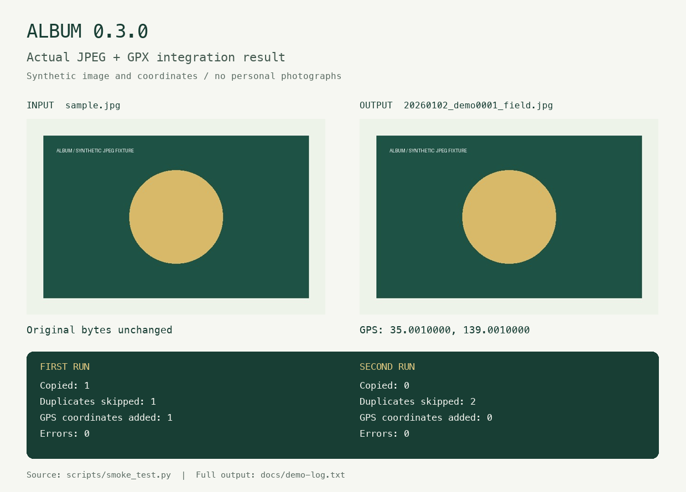

# ALBUM 0.3.0

**Organize photographs by capture date, verify every copy, and optionally add coordinates from a GPS track.**

ALBUM copies an unsorted photo folder into a dated library with consistent filenames. It checks copied bytes with SHA-256 and skips identical files. All processing runs locally; photographs and location data are never uploaded. The name stands for *Automated Library Builder for Unsorted Media*.

[Download](https://github.com/yoneoka-katsuhiro/ALBUM/releases) · [日本語](README-ja.md) · [English manual](docs/MANUAL.md) · [Audit](docs/AUDIT.md)



*The demonstration processes a real JPEG file and a timed GPX track. It adds GPS to the output copy while retaining the original bytes and decoded image pixels. This is a synthetic test fixture, not a photograph or measured route.*

## Download and run

| Archive | Platform | Included runtime |
| --- | --- | --- |
| `ALBUM-v0.3.0-macOS-arm64.zip` | Apple Silicon Mac | Python and ExifTool; uses macOS system Perl. |
| `ALBUM-v0.3.0-Windows-x64.zip` | Windows 10/11, 64 bit | Python, ExifTool, and ExifTool's Perl runtime. |

Choose the ZIP for your system from [Releases](https://github.com/yoneoka-katsuhiro/ALBUM/releases) and extract the **whole folder**. Keep `_internal` and `exiftool` beside the executable. ALBUM is a command-line tool; it does not yet have a graphical photo browser. Packages are development builds without Apple notarization or Windows Authenticode signing. Release notes state the checks completed for each package.

1. Put copies of your photographs in the extracted `album/input_image` folder.
2. Open Terminal on macOS or PowerShell on Windows in the extracted `album` folder.
3. Run the appropriate command. Use letters, digits, `-`, or `_` for names.

macOS:

```bash
./album --photographer yoneoka --location yakushima
```

Windows PowerShell:

```powershell
.\album.exe --photographer yoneoka --location yakushima
```

An output path looks like `output/20260102_yakushima/20260102_yoneoka0001_yakushima.jpg`.

To practise first, use the included [synthetic demonstration](demo/README.md). From the extracted `album` folder, run `./album --project-dir demo --photographer demo --location field --geotag --gps-timezone +09:00` (Windows: start with `.\album.exe`).

## What it does

- Groups copies by date and names them with photographer, sequence number, and location.
- Verifies copies and detects exact duplicates with SHA-256.
- Accepts JPEG, PNG, HEIC, TIFF, and selected RAW extensions.
- Optionally reads timed GPX, NMEA LOG, KML, and GeoJSON to add missing GPS metadata.
- Writes a location CSV, prints progress, and reports failures with a nonzero exit code.

Dates come from `DateTimeOriginal`, then `CreateDate`, then `FileModifyDate`. The last value is a filesystem modification date and may not be the capture date. GPS matching never uses that fallback. Recognition of an image extension does not guarantee that ExifTool can write GPS to every variant of that format.

## Add GPS from a track

Place timed logs in `input_gps`, specify the camera's timezone, and add `--geotag`:

```bash
./album --photographer yoneoka --location yakushima --geotag --gps-timezone +09:00
```

**Version 0.3.0 geotags only the copies in `output` by default.** To modify inputs as well, explicitly add `--geotag-input`; ALBUM then retains a `.album-original` backup for each modified input. Valid existing coordinates are retained. Camera clock errors can produce incorrect locations, and an interpolated position is an estimate.

The [English manual](docs/MANUAL.md) explains all arguments, time matching, CSV fields, and recovery. The [Japanese manual](docs/MANUAL-ja.md) covers the same workflow.

## Run from source or contribute

Source execution requires Python 3.11 or later and [ExifTool](https://exiftool.org/). Run `python album.py --photographer yoneoka`; the existing `album.sh` wrapper also works on macOS. See the [build guide](docs/BUILD.md) for the fixed development environment, regression tests, real-image integration test, and package build commands.

[Changes](CHANGELOG.md) · [Feature ideas](docs/ROADMAP.md) · [Report an issue](https://github.com/yoneoka-katsuhiro/ALBUM/issues)

## License and citation

ALBUM's source is available under the [MIT License](LICENSE). Photos and GPS logs retain their owners' rights. Bundled components retain their own licenses; see [third-party notices](THIRD_PARTY_NOTICES.md).

> Yoneoka, K. (2026). *ALBUM: Automated Library Builder for Unsorted Media* (Version 0.3.0) [Computer software]. https://github.com/yoneoka-katsuhiro/ALBUM

Machine-readable metadata is in [CITATION.cff](CITATION.cff). No DOI has been assigned.
